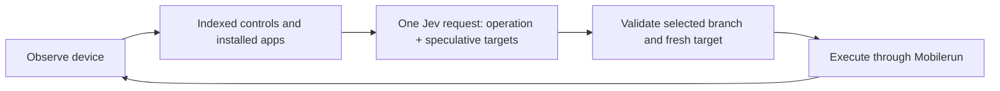

# Mobile Jev

[](https://github.com/droidrun/mobile-jev/blob/main/docs/media/uber-demo.mp4)

**[▶ Watch the demo](https://github.com/droidrun/mobile-jev/blob/main/docs/media/uber-demo.mp4)** — Jev opens Uber, enters a route from San Francisco Airport to the Golden Gate Bridge, and reaches payment selection. The recorded task timer shows about **21 seconds for 9 actions**. A completed booking is not demonstrated.

**One goal. A real Android phone. Jev makes the decisions.**

A standalone mobile agent for [Mobilerun](https://mobilerun.ai), powered by [TypeSafe's Jev](https://docs.typesafe.ai/) and the [Mobilerun API](https://docs.mobilerun.ai/). Includes a live React studio, a CLI, execution traces, and request-level latency measurements. No ADB connection is required.

[Mobilerun](https://mobilerun.ai) · [Mobilerun docs](https://docs.mobilerun.ai) · [TypeSafe](https://typesafe.ai) · [Jev docs](https://docs.typesafe.ai) · [Demo guide](docs/DEMO.md)

## Run it

Requirements: **Node.js 24 recommended** (22.16+ supported), **pnpm 10.30.1**, **curl 7.70+**, a ready Mobilerun Android device, and API keys for Mobilerun and TypeSafe. Tested locally on macOS; CI runs offline tests and the build on Linux.

```sh
git clone https://github.com/droidrun/mobile-jev.git
cd mobile-jev
corepack enable
pnpm install --frozen-lockfile
cp .env.example .env.local
```

Add `MOBILERUN_API_KEY` and `TYPESAFE_API_KEY` to `.env.local`. List your devices, then set `MOBILERUN_DEVICE_ID` to the one you want to control:

```sh
pnpm devices
pnpm doctor
pnpm dev
```

Open **http://127.0.0.1:3040**. Enter a goal and press **Run task**.

- Get a Mobilerun key from [API keys](https://cloud.mobilerun.ai/api-keys).
- Get a TypeSafe key from the [TypeSafe console](https://console.typesafe.ai/). Without a TypeSafe account, Jev is also served by [OpenRouter's TypeSafe-compatible System One API](https://openrouter.ai/docs/guides/community/typesafe-sdk): set `TYPESAFE_BASE_URL=https://openrouter.ai/api` and use an OpenRouter key as `TYPESAFE_API_KEY`.
- Connect or provision your own Android device through Mobilerun. Device/service charges are separate from this project.
- The default API endpoint is production. Set `MOBILERUN_BASE_URL` to your own environment if needed; the code contains no fixed account or device ID.

Already export your variables? That works too. Exported variables take precedence over `.env.local`, which takes precedence over `.env`.

### Local devices over ADB

To control a USB/Wi‑Fi device or emulator directly instead of Mobilerun, install [Android platform-tools](https://developer.android.com/tools/releases/platform-tools), enable USB debugging, and set in `.env.local`:

```sh
JEV_DEVICE_BACKEND=adb
ADB_SERIAL=            # optional when `adb devices` lists exactly one device
TYPESAFE_API_KEY=...
```

`pnpm devices`, `pnpm doctor`, `pnpm agent ...`, `pnpm demo`, and Studio runs then use `adb`; no Mobilerun key is needed. The same freshness checks, element resolution, and input verification apply. Differences:

- UI state comes from `uiautomator dump` (typically 0.5–2 s per read, slower than Mobilerun). Dumps can fail while the screen animates; reads are retried, actions are not.
- `input text` only types ASCII. For other text (e.g. Chinese), install [ADBKeyboard](https://github.com/senzhk/ADBKeyBoard) and set it as the default input method; unsupported text is rejected before any input.
- App labels are derived from package names (`com.android.settings` → `settings`). Set `ADB_APP_LABELS` to a JSON map for better goal matching.
- Studio has no live stream over ADB; use [scrcpy](https://github.com/Genymobile/scrcpy) to watch the device.

### Games and other apps without a UI tree (fixed-position controls)

Game engines such as Unity draw into one surface, so there are no accessibility elements to tap. A **layout profile** declares fixed controls instead. [`layouts/genshin-impact.json`](layouts/genshin-impact.json) covers the Genshin Impact / 原神 mobile HUD: Paimon menu, minimap, tracked quest, teammate list, gadget, attack, skill, burst, jump, sprint, the Paimon-menu shortcuts (inventory, characters, map, quests, …), and the X close button of full-screen menus.

```sh
JEV_LAYOUT=layouts/genshin-impact.json   # or pass --layout PATH to the CLI
pnpm agent layout --out artifacts/layout.png   # calibrate: magenta boxes = buttons, green/red = probes
pnpm agent run "打开派蒙菜单" --execute --steps 5 --wait-timeout-ms 60000
```

- In a profile app, code turns each button into a tappable element placed in the current resolution. Buttons keep their distance from the anchored edge and scale with the short side of the screen. Jev still chooses whether to tap and which button. Other apps use the normal UI tree.
- **Jev accepts text only and cannot see the game.** Add optional pixel `probes` per screen, using a reference-space point and its expected RGB. They let code report the current screen (for Genshin: `world_prompts_1`…`world_prompts_5`, `world_talk`, `world`, `paimon_menu`, `menu`, `dialogue_choice`, `dialogue`, `confirm_dialog`, `world_swimming`, `world_climbing`) and offer only that screen's buttons. Screens are tried in file order, so fallbacks with fewer probes (Genshin climbing: Paimon and jump only) go last. A frame that matches no screen is reported as unknown and offers no fixed control, so Jev can only wait or report being blocked; in a live run it had tapped blindly on an unknown screen and then claimed DONE. A profile without any probes offers every button. Transitions animate, so `unknownRetries` (0–5) re-captures an unrecognized frame before it is shown to Jev, and `settleMs` pauses after each action on a profile screen (unless `--settle-ms` is given) so slow-loading menus are not judged from the previous frame. Traces also record, after each executed action, which control was used on which screen and which screen followed (`layout.previousAction`), for checking outcomes. This record is not sent to Jev: in replayed decisions it made Jev repeat interactions that had already happened. For "do it once" goals, use `--confidence` so an unsure Jev stops instead of acting again.
- A decision made for one detected screen is rejected before input if the screen changes. It is not replayed. DONE inside a game is only a model claim; verify the result yourself. Game frames always differ in pixels, so each profile observation also carries a `layout.signature` of its detected screen and read texts. If the same control is used twice in a row without changing it, the run stops with `no_progress` (for example a pickup that does not happen, or repeated sprinting that Jev cannot see).
- `pnpm agent verify-pickup TRACE --expect one|all|found` checks a Genshin prompt-pickup run independently of Jev's DONE or BLOCKED. It needs the trace (which records the starting screen) and a fresh observation. Every executed action must be a prompt tap, and each tap must shrink the list by exactly one. The final count must match on the last trace frame and the fresh frame, and must be one less than the start (`one`) or empty (`all`). Lists that also contain non-pickup entries, such as 调查, cannot reach empty and fail `all`. `found` is for "find something and pick it up" goals: the run may start without prompts and may use layout routines, but needs at least one confirmed pickup, and a tap that starts a conversation fails it. The report keeps the model status and the verified result separate.
- **Local OCR for declared text regions.** A button can declare a `text` box (its caption, such as a prompt label), and a screen can declare `texts` (such as the dialogue speaker and line). On a recognized screen, code reads only those boxes and puts the text into the button's element text or into a non-clickable `layout-text.<id>` element, so Jev knows which prompt picks up what. A changed caption also makes an older decision stale. Recognition uses the PaddleOCR PP-OCRv4 Chinese line recognizer from the optional dependencies `onnxruntime-node` and `@gutenye/ocr-models`. It runs on your machine, so screenshots never leave it. Loading takes about 0.3 s on first use, and reading takes about 25–60 ms per prompt list and 0.2 s per dialogue screen. Characters under 0.5 confidence are dropped. Set `JEV_OCR=off`, or skip optional dependencies, to disable it. Traces record `layout.ocr` (the number of regions and the time, or `unavailable`/`error`).
- The shipped Genshin coordinates and probes were calibrated on a 2400×1080 emulator with the default touch layout. Interaction prompt lists (talk, pick up, investigate) of 1–5 entries are detected from the grey left rim of each entry; 1 and 3 entries were measured, and 2, 4 and 5 are extrapolated from the 90 px pitch. Prompt labels, reply options, the speaker, up to two subtitle lines and the left-side 「获得」 pickup notice (header plus the first item row) are read with OCR. The pickup notice appears about 2–5 s after the pickup and has no backdrop, so it can be missed on bright scenery; when it is read, Jev can tell that an item was just obtained. A screen text region may set `match` (a regular expression the text must match) and `requires` (another region on the same screen that must also have been read). This drops OCR noise such as the stray characters read from grass and tree edges. The Genshin header must start with 获得, and the item row is kept only together with it. In replayed decisions this turned "pick up one item" from a repeated TAP into DONE. Reply options were measured with two options only. System BACK in the open world opens the quit-game confirmation, so `confirm_dialog` exposes only 取消 (cancel). The teammate list shows only the three inactive characters, so its rows shift when you switch. Check other devices with `pnpm agent layout`. With ADB, game screens are read from `screencap` and `dumpsys window`, not `uiautomator`. Camera drags are not modelled.
- **Routines** are code-owned input loops for what Jev cannot drive one step at a time, such as a held joystick. A profile declares a `joystick` (centre and radius) and a `minimap` box, and each routine appears as one tappable `layout-routine.<id>` element on its `screens` when the device supports raw touch (`AdbDevice.touch`, which sends `input motionevent`). Jev only chooses to start it. The routine runs to a bounded end, and its result (status, frames, turns, per-frame minimap motion) is recorded in the trace as `routine` but not sent to Jev. The `explore` type holds the joystick in a random direction (`deflection` of its radius), checks a PNG frame about every 1.6 s, and changes direction every few frames. It stops with `found` when a `stopScreens` screen appears. It only arms after leaving a stop screen it started on, confirms the prompt with the joystick released, and steps back once (`backstepMs`) if it overshot. It stops with `interrupted` on any other screen or on two unknown frames in a row, `stuck` after `stuckLimit` frames whose minimap barely moved (it taps `stuckButton` and turns each time), `frozen` when two consecutive frame pairs are pixel-identical (a hung game), or `timeout` at `maxMs`. On a `recover` screen it first pushes up for `recoverAfter` frames, then taps the given button and turns back: Genshin climbing climbs on, then drops (攻击键 becomes 下落). On entering a `turnScreens` screen (Genshin water) it turns back towards land. The joystick is always released, also on errors. Raw `screencap` returned stale frames on LDPlayer, so frames use PNG.

## Included demo: enable dark theme

Ask **“Turn on dark theme in Android Settings.”** Jev discovers Settings from the device's installed apps, opens it through the Mobilerun API, selects the relevant controls, and changes the setting. The demo runner reads the screen again and verifies the actual Dark theme switch is on; it does not accept a model DONE response as proof.

```sh
pnpm demo dark-theme --reset
```

`--reset` first asks Jev to establish and verify an off baseline. Setup, task execution, and verification have separate timings. Every attempt is retained locally, including failures. This is a small reproducible utility demo without accounts, purchases, or travel-app loading. See [what the demo does and its limits](docs/DEMO.md).

## The studio

- A live device stream using the official [`@mobilerun/react`](https://www.npmjs.com/package/@mobilerun/react) component.
- Goal input, executed-action timeline, model latency, and a task clock that stops on completion, failure, or cancellation.
- Stop control, reconnect, fullscreen, and recent runs. Clear removes finished runs and resets the timer. One task owns the configured device at a time.
- The desktop workspace fits in one viewport; activity scrolls inside its panel.

The account API keys stay on the server. The browser receives device-scoped streaming credentials only. The app binds to localhost, validates request origins, and is intended for a single local operator. Public/multi-user hosting requires your own authentication and device authorization. Recent runs are held in memory and cleared on server restart.

## Use the CLI

```sh
# Preview the next decision, without executing it:
pnpm agent run "Turn on dark theme in Android Settings."

# Execute a goal and retain the real model decisions:
pnpm agent run "Turn on dark theme in Android Settings." \
  --execute --steps 20 --trace artifacts/dark-theme.jsonl

# Inspect a phone or measure the API:
pnpm agent observe
pnpm agent screenshot
pnpm agent profile --out artifacts/api-profile.json

# Direct controls for debugging:
pnpm agent tap 300 500
pnpm agent type "San Francisco" --clear
pnpm agent back
```

Use `--device ID` to override the configured device. `pnpm agent --help` lists all options. Traces and screenshots are ignored by git and never overwrite an existing file.

## How Jev drives it



Jev chooses `OPEN_APP`, `TAP`, `TYPE_TEXT`, scrolling, navigation, `WAIT`, `DONE`, or `BLOCKED`. Operation and compatible-target questions share one request; unused target answers cannot execute. App launch targets come from the installed-app API. When a goal names installed apps explicitly, exact name matching narrows that inventory; otherwise up to 200 apps are offered and the launcher remains available.

The executor resolves coordinates from observed bounds. It validates probability distributions, rejects stale targets, and never retries a device mutation after an uncertain transport failure. It records actions before the next observation, so a failed read cannot erase an executed action.

Text comes from exact spans in the goal. Jev selects a span; code copies it into the field. Supply `--text "exact field value"` to override those candidates. This implementation does not generate arbitrary prose or invent missing personal details. A separate text-generation model is not needed.

Text replacement uses the API's faster `accepted` completion mode when the focused field can be read back. The agent verifies the complete field value in its next observation before asking Jev to continue; an unverified value stops the run without retyping. Appends, password fields, and fields without a readable target retain server-side `committed` completion. Set `MOBILERUN_TEXT_COMPLETION_MODE=committed` (or CLI `--text-completion committed`) to use that mode for every input.

Confidence is visible and an optional `--confidence` cutoff is available. **Jev's DONE response is not independent proof of success.** Check the resulting device state, especially for numeric values, dates, and multi-part goals. The demo runner provides task-specific verification; see [the demo guide](docs/DEMO.md).

## Speed and reproducibility

The model transport reuses its HTTPS connection. Device readiness is cached briefly. The loop observes immediately after actions, with bounded polling for transitions, rather than sleeping after every interaction. Jev still chooses every operation; there are no prepared tap sequences in the policy.

Request timings split DNS, TCP/TLS, response wait, and download from total wall time. Response wait includes network, server, and device work—not just server processing. A 300 ms swipe also includes its requested gesture duration. See [the demo guide](docs/DEMO.md) for measurement boundaries, successes, and failures.

An identical prompt is not guaranteed to produce an identical trace. App version, locale, current screen, account state, network, and model version affect results. `jev-latest` is convenient; set `TYPESAFE_MODEL` to a supported fixed version when comparing runs, and retain the returned model name in the trace.

## Development

```sh
pnpm check       # tests, lint, typecheck, formatting, production build
pnpm build
pnpm start      # production studio on localhost:3040
```

CI requires no API keys and does not control a phone. Live `run --execute` and demo commands make real model/device requests.

| Directory               | Purpose                                                          |
| ----------------------- | ---------------------------------------------------------------- |
| `scripts/mobile-agent/` | Device adapter, Jev policy, executor, transports, CLI and tests  |
| `apps/jev-studio/`      | Next.js studio, device credentials route, SSE and task lifecycle |
| `scripts/doctor.mjs`    | Configuration and device connectivity checks                     |
| `scripts/demo.mjs`      | Repeatable demo and outcome verification                         |
| `layouts/`              | Fixed-control profiles for games without a UI tree               |
| `artifacts/`            | Local-only traces, screenshots and measurements                  |

MIT licensed; dependencies retain their respective licenses.
