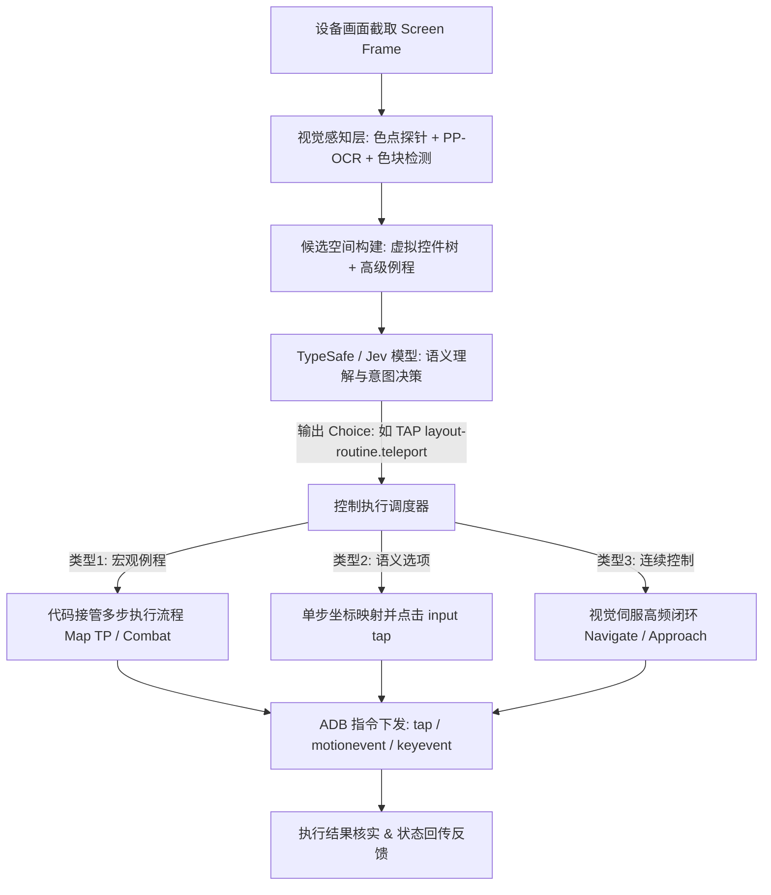
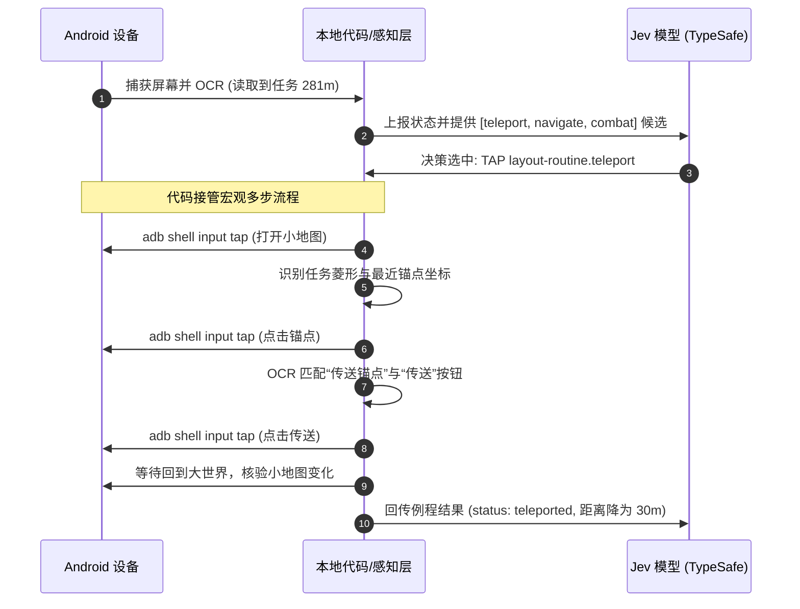

# 原神控制逻辑实现原理报告

本报告阐述在无系统无障碍树（Accessibility Node Tree）的原神（Unity 游戏）环境中，Jev 移动 Agent 如何实现高精度、高响应度的控制逻辑。

---

## 1. 核心架构：意图决策与机械执行解耦

游戏画面多变、缺乏标准控件且元素位置极不固定。本项目的核心原则为：**Jev 拥有策略决策权，代码拥有候选发现、验证、坐标解算与执行控制权**。



---

## 2. 三大控制逻辑范式及差异对比

针对游戏内的不同操作特点，系统抽象并实现了三类截然不同的控制逻辑：

### 范式一：宏观功能型例程（以地图传送 Teleport 为例）

- **定位**：跨越长距离、需要多步界面切换与重试的宏观行为。
- **分工机制**：
  - **Jev 视角**：Jev 并不感知屏幕上具体的锚点叫什么名字或在哪个像素坐标。Jev 仅根据 HUD 上的长距离（如 `281m`）决定调用 `Teleport near quest` 这一高级意图。
  - **代码视角**：代码接管长达数十秒的机械执行流：
    1. 检查 HUD 距离，若很近（如 $\le 150\text{m}$）则直接返回 `quest_near`，拒绝传送；
    2. 点击小地图打开大地图界面；
    3. 全屏色块扫描，寻找任务蓝色菱形与带白色高光环的已解锁传送锚点；
    4. 计算最近锚点并点击；
    5. OCR 确认弹出面板为“传送锚点”并点击“传送”；
    6. 等待大世界加载完成，对比小地图像素位移确认传送成功。



---

### 范式二：语义内容选择（大世界多重交互、剧情分支）

- **与范式一的核心差异**：
  - 范式一中 Jev 只选抽象能力，代码隐藏具体名字；
  - 范式二中**必须由 Jev 理解真实的自然语言语义**来决定点选哪一项。
- **分工机制**：
  1. 角色靠近多个物体或 NPC 时，屏幕右侧浮现 1~5 个交互槽位（`world_prompts_1` ~ `world_prompts_5`）；
  2. 代码裁剪对应槽位区域，利用 **PP-OCR** 实时抓取真实文本（如 `[1] 调查`、`[2] 拾取: 甜甜花`、`[3] 与 派蒙 对话`）；
  3. 代码将这些**真实语义文本作为动态可选控件**直接送入 Jev 的候选树；
  4. Jev 结合当前任务目标（例如“调查周围的异常”）选择具体序号；
  5. 代码将选中的槽位序号映射回屏幕固定高度，下发 `adb shell input tap X Y`。

---

### 范式三：毫秒级视觉伺服闭环（寻路 Navigate、找怪接近 Approach）

- **与范式一/二的核心差异**：
  - 前两者均为离散点击；寻路是**连续反馈控制（类似无人驾驶 PID 循迹）**。
  - 大模型推理延迟（百毫秒~秒级）无法直接控制实时走位和相机旋转，必须由代码层构建高频控制回路。
- **分工机制**：
  1. Jev 下发一次 `navigate` 指令后，代码启动最大约 20~30 秒的本地自主循环；
  2. **帧级偏差解算**：实时从小地图计算**视锥朝向（Cone Heading）**与**任务黄点方位角（Marker Bearing）**的角度差 $\Delta \theta$；
  3. **姿态纠偏**：若 $|\Delta \theta| > 20^\circ$，在屏幕右侧滑动模拟拖拽视角；
  4. **动力驱动**：通过 `adb shell input motionevent DOWN -> MOVE` 将左下角虚拟摇杆推向正前方；
  5. **局部光流防卡死（Region Motion）**：持续比对小地图连续帧像素差异，若连续多次检测到无位移（撞墙或攀爬卡住），自动触发跳跃键脱困（`stuckButton: jump`）；
  6. **退出条件**：黄点进入小地图中心（`arrived`）、路遇对话（`found`）、脱困失败（`stuck`）或超时，释放摇杆并将结果汇报给 Jev。

```mermaid
graph LR
    subgraph 视觉伺服闭环 (Navigate Routine)
        F[抓取实时帧] --> Calc[计算视锥与目标角度差]
        Calc -->|角度偏差过大| Cam[滑动右屏调整相机视角]
        Calc -->|角度对齐| Joy[保持推摇杆: input motionevent MOVE]
        Joy --> Mot[计算小地图像素光流 Motion]
        Mot -->|Motion < 阈值 判定卡墙| Stuck[触发跳跃脱困 input tap Jump]
        Mot -->|到达中心 / 发现NPC / 超时| Break[释放摇杆 input motionevent UP]
    end
    Break --> Ret[向 Jev 汇报最终状态: arrived / found]
```

---

## 3. 数据交互契约（以地图 TP 为例）

发送给 TypeSafe (`jev-latest`) 的决策请求 Schema 如下：

```json
{
  "model": "jev-latest",
  "state": {
    "goal": "前往蒙德城并与安柏对话",
    "app": "com.miHoYo.Yuanshen",
    "fixedLayout": {
      "profile": "Genshin Impact mobile HUD (default layout)",
      "screen": "world",
      "description": "Open world 大世界界面，左上角显示小地图与任务HUD，右侧为攻击技能区。"
    },
    "isEditable": false,
    "visibleText": ["消灭所有魔物，并拆除魔物营地", "281m"],
    "elements": [
      {
        "index": "1",
        "label": "routine \"Go to quest marker 前往任务标记: 朝小地图黄色标记跑动寻路...\"",
        "editable": false,
        "scrollable": false,
        "operations": ["TAP"]
      },
      {
        "index": "2",
        "label": "routine \"Teleport near quest 传送到任务附近: 打开大地图，自动寻找并点击离任务最近的已解锁锚点并确认传送。适用于远距离(数百米以上)...\"",
        "editable": false,
        "scrollable": false,
        "operations": ["TAP"]
      },
      {
        "index": "3",
        "label": "routine \"Fight 战斗: 释放战技/爆发并普攻敌人...\"",
        "editable": false,
        "scrollable": false,
        "operations": ["TAP"]
      }
    ],
    "recentActions": [
      {
        "operation": "TAP",
        "label": "routine \"Go to quest marker 前往任务标记\"",
        "screenChanged": false
      }
    ]
  },
  "questions": {
    "operation": {
      "type": "choice",
      "instructions": {
        "goal": "前往蒙德城并与安柏对话",
        "rules": "根据当前画面和目标选择一个最有效推进任务的操作。"
      },
      "criteria": {
        "TAP": "点击屏幕上的可见按钮或例程",
        "WAIT": "等待加载或目标出现",
        "DONE": "目标已全部达成",
        "BLOCKED": "无法执行任何操作推进目标"
      }
    },
    "tap_target": {
      "type": "choice",
      "instructions": "如果执行 TAP，请选择最优目标编号。",
      "criteria": {
        "1": "[1] routine \"Go to quest marker 前往任务标记\"",
        "2": "[2] routine \"Teleport near quest 传送到任务附近\"",
        "3": "[3] routine \"Fight 战斗\""
      }
    }
  }
}
```

### 关键字段解析

| 字段路径               | 说明                                                                      |
| :--------------------- | :------------------------------------------------------------------------ |
| `state.goal`           | 顶层任务自然语言目标。                                                    |
| `state.fixedLayout`    | 色点探针识别出的当前界面类型（如 `world`、`world_map`、`dialogue`）。     |
| `state.visibleText`    | PP-OCR 实时裁剪 HUD 得到的文字列表（如任务目标及当前距离 `281m`）。       |
| `state.elements`       | 抽象后的虚拟控件树与例程能力列表。                                        |
| `questions.operation`  | Jev 评估的主操作选择（`TAP` / `WAIT` / `DONE` / `BLOCKED`）。             |
| `questions.tap_target` | 当主操作为 `TAP` 时对应的目标候选池，Jev 输出对应概率分布并选出最优序号。 |

---

## 4. 范式特性对比表

| 维度             | 范式一：宏观功能型（TP / 自动战斗）    | 范式二：语义判定型（拾取 / 剧情分支） | 范式三：视觉伺服闭环（寻路 / 接近敌人）        |
| :--------------- | :------------------------------------- | :------------------------------------ | :--------------------------------------------- |
| **典型代表**     | `teleport`, `combat`, `dialogue`       | 调查/拾取槽位（1~5行）、剧情选项      | `navigate`, `approach`                         |
| **Jev 的职责**   | 下发高层业务意图                       | 理解 OCR 提取出的文本并做逻辑分支选择 | 下发移动意图，接收最终停走原因                 |
| **代码层的职责** | 状态机多步跳转、色块查找、确认按钮定位 | 区域文本裁剪、OCR 识别与候选组装      | 高频角度算差、相机平滑拖拽、摇杆长按、卡死检测 |
| **交互频率**     | 离散单次决策，耗时几十秒               | 离散单次决策，逐项确认                | 连续高频闭环（300~700ms 刷新周期）             |
| **坐标依赖**     | 动态计算（大地图扫描色块与高光环）     | 相对固定（预设插槽坐标）              | 相对固定（虚拟摇杆区 + 相机旋转区）            |
